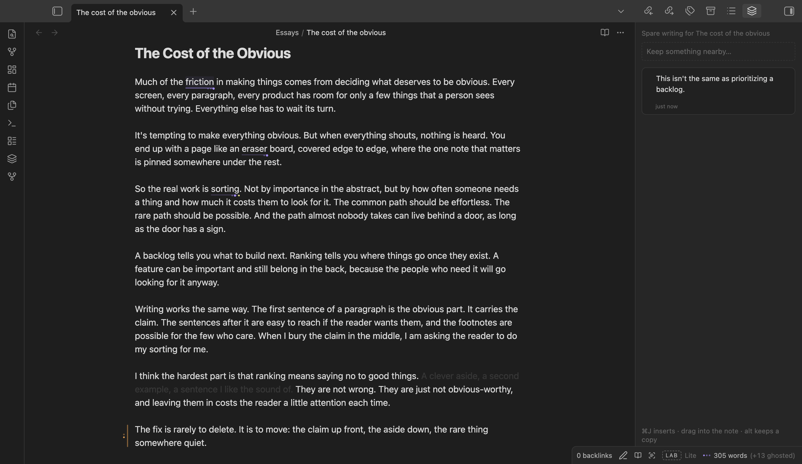

# Vikalp

*Vikalp* is Hindi for "alternative". It's an Obsidian plugin for settling on the right way to say something: keep several versions of a word, sentence or paragraph in place, dim text instead of deleting it, keep spare writing nearby, lint on demand, and ask AI for options, marks and cuts.

Inspired from [Jason's](https://x.com/jasonfried/status/2105403067793584590) and [Jhey's](https://x.com/jh3yy/status/2102885700979048558) tweets.



## What it does

- **Alternatives.** Put the cursor on a word, press ⌘J, type versions. Press ⌘J again for the sentence, again for the paragraph. Hover and press the arrow keys to read each one in place. Whatever is showing is the note.
- **Ghosting.** Fade a passage instead of deleting it. Revive it later, or copy the note without it.
- **Overflow.** A per-note side panel for writing you cut but want nearby. Drag it back when it fits.
- **Linter.** Rules for hedging, wordiness, AI-sounding phrases, LinkedIn voice, repetition, passive voice and more. Edit them or add your own as YAML. Judgment rules use Jev, TypeSafe's yes/no model.
- **The Lab.** AI passes that mark typos, weak or convoluted sentences, off-tone words and hedges, and trim levels that fade the words a model would cut. You keep or cut each one.
- **Read-through.** Hide every marker and read like a reader.

Read [docs/using-vikalp.md](docs/using-vikalp.md) for the full guide and hotkeys, or see [vikalp-tau.vercel.app](https://vikalp-tau.vercel.app).

## Network use

Alternatives, ghosting, Overflow, the local lint rules and read-through work offline.

The AI features (AI versions, judgment lint rules and the Lab) send text to [OpenRouter](https://openrouter.ai) with your own API key. OpenRouter passes it to the model you picked. Asking for AI versions sends the note title, the paragraph and the paragraphs on either side. Lab passes and judgment rules send the open note. Nothing is sent until you click something, and nothing is sent without a key. You pay OpenRouter for what you use; the Lab shows the cost of every call.

Vikalp has no telemetry and no account.

## Install (from source)

```sh
npm install
npm run build
```

Copy `main.js`, `manifest.json` and `styles.css` into `<your vault>/.obsidian/plugins/vikalp/`, enable Vikalp in Settings → Community plugins, and add an OpenRouter API key in Vikalp's settings for the AI features. Turn on **Use suggested hotkeys** in the same settings for ⌘J, ⌘⇧J and ⌘., or set your own in Settings → Hotkeys. Desktop only.

## Develop

- `npm run dev` builds in watch mode into `dev-vault/`. Open `dev-vault` in Obsidian with the Hot Reload plugin to see changes live.
- `npm test` runs behaviour tests. `npm run e2e` runs the end-to-end flows in an isolated Obsidian. `npm run shots` refreshes the screenshots.
- Start with [docs/architecture.md](docs/architecture.md). Storage is described in [docs/storage.md](docs/storage.md), rules in [docs/rules.md](docs/rules.md).

## Docs

- [Using Vikalp](docs/using-vikalp.md)
- [Architecture](docs/architecture.md)
- [Storage](docs/storage.md)
- [Lint rules](docs/rules.md)
- [Adding a Lab pass](docs/adding-a-lab-pass.md)
- [Testing](docs/testing.md)

## Notes for your vault

- Vikalp shows its own word count (without ghosted words) in the status bar. If Obsidian's core *Word count* plugin is on, you'll see two counts; turn the core one off in Settings → Core plugins if that bothers you.
- Sidecars live in `.obsidian/plugins/vikalp/notes/`. See [docs/storage.md](docs/storage.md) for what that means for sync.
