# Using Vikalp

Vikalp helps you settle on the right way to say something. Keep several versions of a word, sentence or paragraph in place and read each one in context. Dim text instead of deleting it. Keep spare writing nearby. Lint on demand. Ask AI for options, marks and cuts, never for prose.

Nothing runs or costs money until you click something.

The keys in this guide (⌘J, ⌘⇧J, ⌘.) are Vikalp's suggested hotkeys. They're off until you turn on **Use suggested hotkeys** in Settings → Vikalp → Hotkeys, so Vikalp never takes a key another plugin uses. You can also set your own in Settings → Hotkeys.

## Markers

The word count in the status bar is also the switch. Click it to show or hide Vikalp markers for the note. Creating a span turns markers on for you.

- A word or sentence with versions has a thin underline and a row of tiny dots under its end. One dot per version; the bright one is showing. The first dot is the original, so you can tell when you're on a variant.
- A paragraph with versions has a thin bar in the left margin with a column of dots.
- A yellow dot means the span has a note. Hover it to read the note.

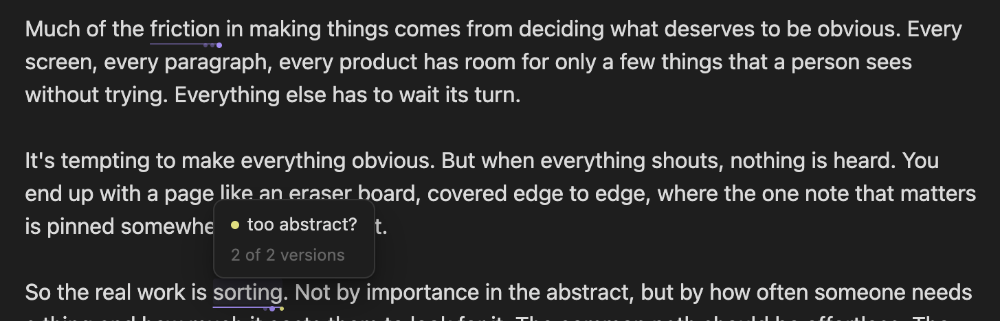

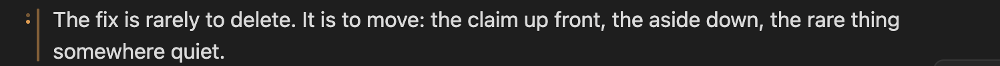

## Alternatives

1. Put the cursor on a word, or select a phrase, and press **⌘J** (or right-click → *Alternatives for selection*). A partial word grows to the whole word. Press **⌘J** again to widen to the sentence, and again for the paragraph.
2. The Alternatives panel opens on the left with the cursor in its input. Type a version and press **Return**. It shows in the note straight away.
3. Add as many as you like. **↑/↓** in the panel swaps the version in the note as you go.
4. **Esc** goes back to the note. A span you never gave a second version quietly disappears.

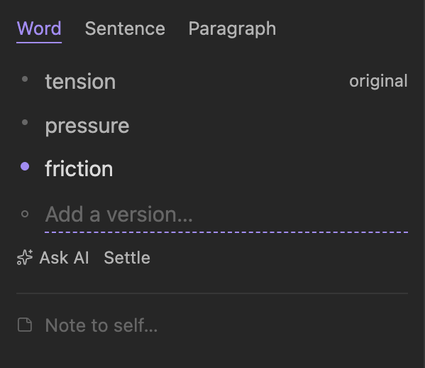

To cycle in the note:

- **Hover** the span and press the **arrow keys**. Typing disarms this until you move the mouse again, so arrows never get stolen while you write.
- Or put the cursor in the span and press **⌥↑ / ⌥↓**.
- **⌥⌫** while hovering deletes the showing version.

There's no accept step. Whatever is showing is the note. Undo (**⌘Z**) reverses any swap.

When you swap, a preceding "a" or "an" is fixed to match ("a thumbtack" → "an eraser").

The **Word · Sentence · Paragraph** tabs grow the current span or selection to that unit.

A paragraph span can contain word spans. If you switch to a paragraph version that doesn't contain one of them, it hides until a version that does comes back.

The **⋯** under the list has **Settle** (keep the showing version and drop the rest), **Remove AI versions** and **Add a note**. *Settle all alternatives in note* does it for every span, after asking.

### AI alternatives

- Press **⌘⇧J**, or type **??** in the panel input and press Return, or click **Ask AI**.
- Options stream in marked with a small robot. Your showing version never changes; you pick.
- Each AI version remembers which model wrote it (hover it in the panel).
- *Remove AI versions* clears them from a span. AI versions aren't part of undo, so ⌘Z never steps through them.
- **Find words worth playing with** (in the Lab, or right-click a selection) does this for the whole note in one go. The model picks up to 8 words or short phrases where the wording matters most and adds versions to each. Nothing in the note changes; hover a marked word and use the arrow keys. *Remove all AI versions in note* clears them again.

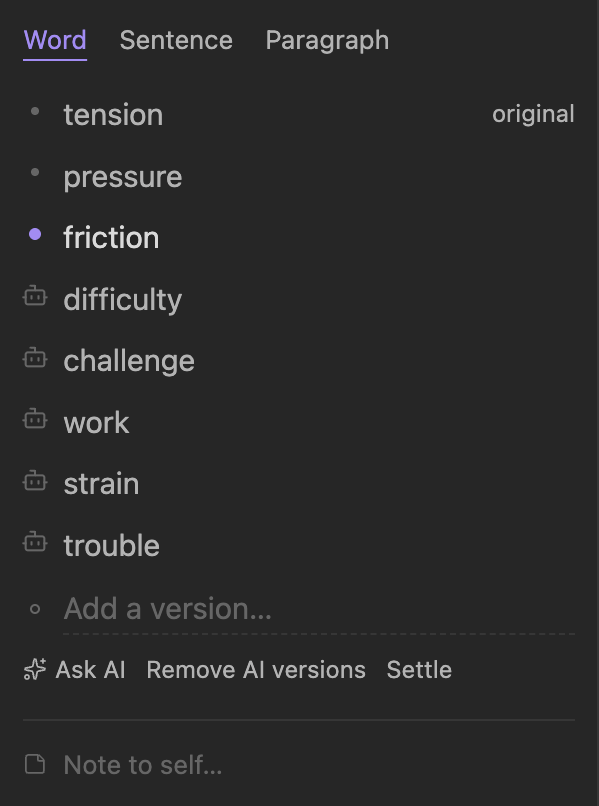

## Ghosting

Select text and press **⌘.** then **G** (or right-click → *Ghost it*). It fades to about a third and stays in the note. Hover to read it. Right-click → *Revive* brings it back.

Ghosted words aren't counted in the status bar; the count shows them as "(+12 ghosted)". *Copy clean text* copies the note without them. *Delete all ghosted text in note* removes them for good, after asking.

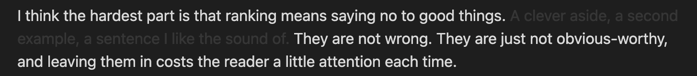

## Overflow

A side panel for writing you cut but want nearby. Each note has its own.

- Select text and press **⌘.** then **S** to move it to Overflow.
- Drag a block back into the note, or focus it and press **⌘↵** to insert it at the cursor. Hold **⌥** to keep a copy.
- Blocks are editable. Drag them to reorder.
- With a span open in the Alternatives panel, the split icon on a block makes it a version of that span.

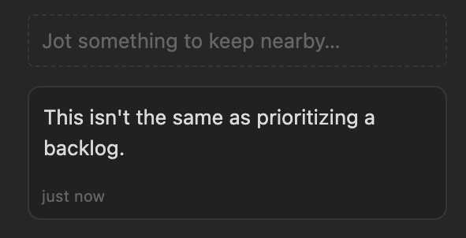

## Linter

Click the lint icon in the status bar, the **Run linter** button in the Lint panel, or run *Vikalp: Run linter*. Free local rules finish at once. Judgment rules (awkward, LinkedIn voice, AI-sounding paragraphs, and so on) fill in as Jev answers.

Hover a mark to see which rules it hit, and fix or ignore it. Click a hit in the panel to jump to it, or click a mark in the note to find it in the panel. The toggle at the top of the Lint panel switches between grouping by rule and one flat list in the order marks appear, for working down the note. Marks made by a model (Jev or an LLM) carry an **AI** label and a faint dashed underline.

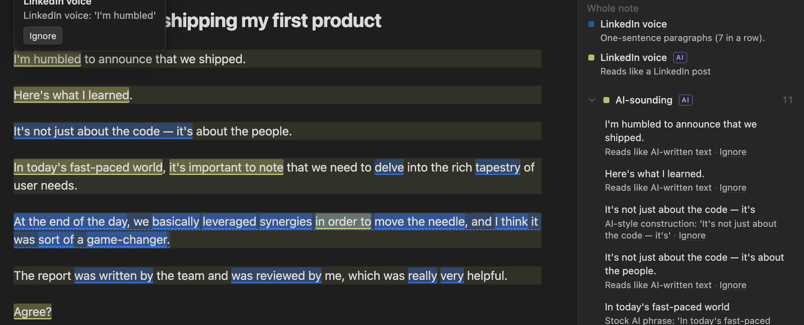

Rules live in Settings → Vikalp → Rules, grouped by name. Switch a group or a single check off, open any rule to edit it in a form, or press **Add rule**. The form previews how many marks a rule makes on the open note before you save. Select a phrase you hate and run *New rule from selection* to flag it everywhere from now on. See [rules.md](rules.md).

## The Lab

Click **Lab** in the status bar.

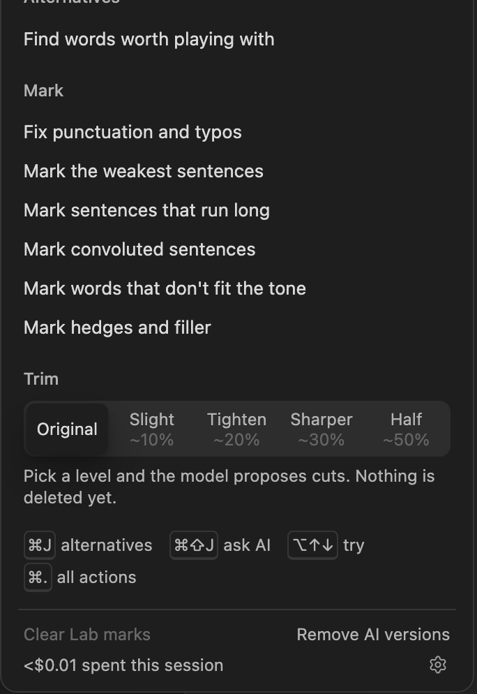

- **Model**: Lite, Medium or Heavy. Applies to every AI action. The status bar shows the current mode next to **Lab**. With Ollama, LM Studio or a custom server there is one model, and the Lab and the status bar show its name instead. Hover either to see the provider and model.
- **Mark** passes add marks you can review in the Lint panel: typos and punctuation (with Apply / Ignore and *Apply all*), weakest sentences, sentences that run long, convoluted sentences, words that don't fit the tone, and hedges and filler.
- **Trim** levels strike through the words the model would cut, from ~10% to ~50%. Click a struck passage to keep it. Then **Ghost the cuts** (nothing is deleted), **Make the cuts**, or **Walk through** them one at a time with **K**eep, **C**ut, **S**kip. **Done** discards what's left. Switching levels keeps the passages you chose to keep.

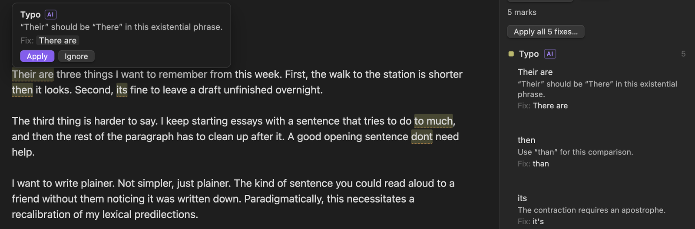

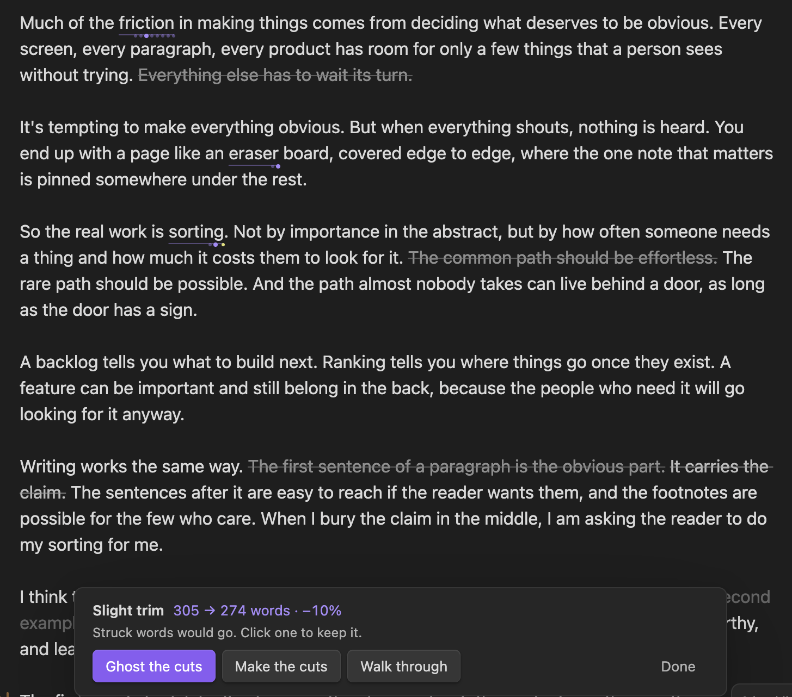

The model may only quote your own text. Anything it can't quote exactly is dropped and counted.

## Read-through

**⌘.** then **R** hides every marker, collapses the sidebars and narrows the text so you read like a reader. Ghosted text stays dimmed. **Esc** returns.

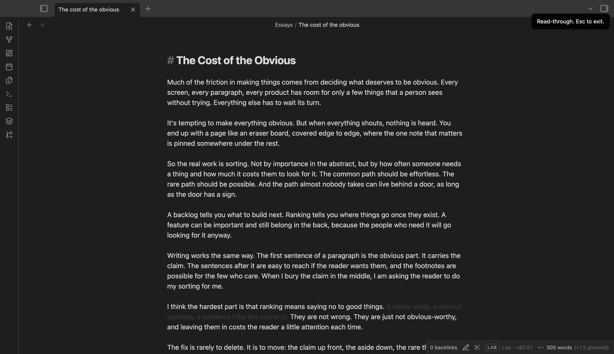

## AI provider

Pick one in Settings → Vikalp → AI → **Provider**:

| Provider | What you need | Models |
|---|---|---|
| OpenRouter | An OpenRouter API key | Lite, Medium and Heavy, any model OpenRouter has. The only one with Jev for judgment rules. |
| Anthropic | An Anthropic API key | Lite, Medium and Heavy: Haiku, Sonnet and Opus by default |
| OpenAI | An OpenAI API key | Lite, Medium and Heavy: gpt-6-luna, gpt-6.1-sol and gpt-5.6-sol by default |
| Ollama | [Ollama](https://ollama.com) running, with a model downloaded | One, picked from the models Ollama has |
| LM Studio | LM Studio's server started, with CORS turned on in its Developer tab | One, picked from the models LM Studio has |
| Custom | The URL of any OpenAI-compatible server, and a key if it asks for one | One |

Ollama and LM Studio run models on your own machine, so the text stays there. Small local models are much weaker at marking and trimming than the hosted ones. For OpenRouter, Anthropic and OpenAI, each mode has a list of suggested models. Lite lists the newest Luna and Haiku. Medium lists the newest Sol and Sonnet. Heavy lists the newest Astra, Opus and Fable. On OpenRouter the lists also suggest two open models for each mode. Vikalp picks them by their Artificial Analysis intelligence score, from open-weight models that cost no more than the other models in that mode. It checks for new ones once a day while settings are open. Choose **Custom…** to type any other model id.

Each provider keeps its own key and models, so you can switch back and forth. Named providers keep their server URL under **Advanced**, for a regional endpoint or an OpenAI-compatible proxy.

Jev only runs on OpenRouter. Elsewhere judgment rules ask the selected model, and the grammar check after a trim is skipped.

## Cost

The Lab popover shows this session's AI spend and links to a log of every call: what it was for, the model, tokens and cost. Each linter run also shows its own cost in the Lint panel. On Ollama or LM Studio the Lab shows **Free**. For a custom server whose prices Vikalp doesn't know, it shows tokens instead, after any dollars already spent.

## Keys

Four keys cover almost everything once you turn on suggested hotkeys. The Alternatives panel and the Lab popover show whichever keys you have.

| Key | What it does |
|---|---|
| **⌘J** | Alternatives for the word at the cursor or the selection. Again: the sentence. Again: the paragraph. |
| **⌘⇧J** | Ask AI for versions |
| **⌥↑ / ⌥↓** | Try versions from the note (or hover a marked word and use the arrow keys) |
| **⌘.** | Every other action, one letter away |

The **⌘.** menu:

| Letter | Action |
|---|---|
| A | Alternatives |
| I | Ask AI for versions |
| F | Find words worth playing with |
| G | Ghost it (or Revive on ghosted text) |
| S | Stash in Overflow |
| L | Run linter |
| T | Open the Lab |
| R | Read-through |
| C | Copy clean text (or the selection) |

In the Alternatives panel: **↵** adds a version, **↑/↓** tries them in the note, **??** asks AI, **esc** goes back to the note. In Overflow, **⌘↵** inserts the focused block at the cursor. While hovering a marked word, **⌥⌫** deletes the showing version.

Every action is also a command (search "Vikalp" in the command palette), and any key can be changed in Settings → Hotkeys.
